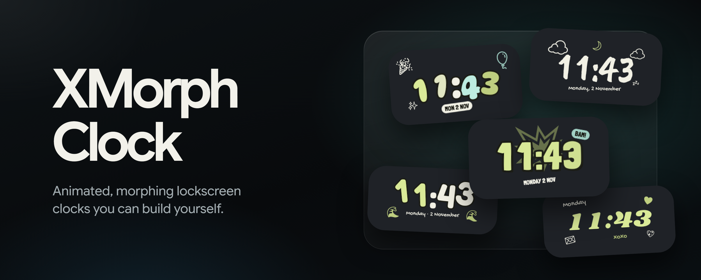

  

# XMorph Clock

Give your lockscreen a clock that's truly yours.

XMorph Clock replaces the stock lockscreen clock with beautiful, animated clock faces. Digits morph smoothly every minute, the clock flows between the big and small styles, and it melts into a calm look on the Always-on Display. You can also add weather, widgets, your own text and photos anywhere on the lockscreen.

## Features

- **A face for every mood.** Expressive, artistic, playful, analog, elegant, classic, graphic and digital styles, ready to apply or remix.
- **Smooth animations.** Digits roll, flip, fade or slide on every minute change. The clock morphs between its large and small styles and into the AOD look.
- **Weather.** Current conditions, temperature, high and low, humidity and more. It works out of the box without an account. Use your current location or pick a city.
- **Widgets.** Battery, steps, data usage, and quick toggles you can tap right on the lockscreen: Wi-Fi, Bluetooth, flashlight, Do Not Disturb and more.
- **Your own elements.** Add text, icons, photos, rings, bars, the date and more as separate items. Text can include live values like the time, temperature or battery.
- **Place anything anywhere.** Move items, resize them, and change their order in the editor. Each item remembers its position separately for the large clock, the small clock and the AOD.
- **Full styling.** Colours and gradients that can follow your wallpaper. Glass, blend and outline effects, 40+ fonts with adjustable weight, width and height, rounded shapes and backgrounds.
- **Depth effect.** The subject of your wallpaper can sit in front of the clock, like on iOS. Subject opacity is adjustable.
- **AOD friendly.** Choose how every element looks on the Always-on Display: thin, outlined, dimmed, monochrome or hidden. Burn-in protection is built in.
- **Live preview.** Everything is edited on a preview of your own wallpaper and lockscreen before it's applied.

## Supported phones and ROMs

XMorph Clock works on Google Pixel phones running stock Android, and on custom ROMs that keep Google's lockscreen.

| Android version | Supported |
|---|---|
| Android 17 | ✅ Yes |
| Android 16 | ✅ Yes |
| Android 15 | ✅ Yes |
| Android 14 | ✅ Yes |
| Android 13 | ✅ Yes |
| Android 12 | ✅ Yes |

On Android 12, the glass look is replaced by a simpler translucent style, because the system can't render it.

**ROMs**

- **Pixel stock firmware:** fully supported.
- **AOSP and Pixel-based custom ROMs** built on a supported Android version, such as PixelOS-style ROMs: should work, as long as the ROM keeps the stock lockscreen.
- **Manufacturer skins** such as Samsung One UI, Xiaomi HyperOS, OnePlus OxygenOS, OPPO ColorOS, vivo OriginOS, Nothing OS and similar: **not supported.** They use their own lockscreens.

Not sure about your phone? Install the app and open **Status**. It shows right away whether your lockscreen is supported.

## What you need

- **Root access:** Magisk, KernelSU or APatch.
- **An Xposed framework** that supports the modern Xposed API, such as **LSPosed** or **Vector**.
- **Google Play services:** only needed for the depth effect. Everything else works without it.

## Installation

1. Download the latest APK from [Releases](https://github.com/Mahmud0808/XMorphClock/releases) and install it.
2. Open your Xposed manager (for example LSPosed), enable **XMorph Clock**, and make sure **System UI** is ticked in its scope.
3. Grant XMorph Clock root access. Magisk asks when you open the app; on KernelSU and APatch, allow it in the manager first.
4. Restart System UI from the app's **Status** screen.
5. Lock your phone and enjoy your new clock.

## Using the app

- **Pick a face:** scroll the faces at the bottom and tap one to apply it. **Large**, **Small** and **AOD** on the preview show each state.
- **Add something:** tap **+** to add weather, widgets, text, icons, photos and more.
- **Move and resize:** tap an item to select it (tap again to pick a single element inside it), then tap Edit. In the editor, long-press and drag to move it, drag the corner handle to resize, or remove it.
- **Edit:** tap **✎** to change colours, fonts, effects, sizes, AOD look and visibility for each state.
- **Save your style:** after changing things, open **⋮** and pick **Save as preset** or **Update preset**. Your styles appear under **Created by you**.
- **Settings:** open **⋮** → **Settings** to turn the clock on or off, set up weather (provider, city, units), enable the depth effect, import or export your presets, and switch between light and dark mode.

## Troubleshooting

- **The lockscreen still shows the stock clock.** Make sure XMorph Clock is enabled in your Xposed manager with **System UI** in its scope, then restart System UI from the **Status** screen.
- **Status says my build isn't supported.** Your Android version or ROM isn't supported yet. See the table above.
- **Weather shows "--".** Open **Settings → Weather** and check location access, or set a city manually. If it says the service is busy, it retries on its own.
- **Steps stay at 0.** Steps are read from Health Connect. Make sure an app such as Google Fit or Fitbit records your steps there.
- **Something else is wrong.** Open **Status**, tap **Save report**, and attach it when you open an issue.

## Credits

- [AndroidLiquidGlass](https://github.com/Kyant0/AndroidLiquidGlass) by Kyant0, for the glass interface
- Roboto Flex, Google Sans Flex and other fonts under the SIL Open Font License
- Material Symbols by Google
- Weather data from [Open-Meteo](https://open-meteo.com), [MET Norway](https://api.met.no) and [OpenWeatherMap](https://openweathermap.org)
- Subject detection by ML Kit

Full license texts are in the app under **⋮ → About → Licenses**.

## Author

Made by [DrDisagree](https://github.com/Mahmud0808).

## License

Copyright (C) 2026 Mahmudul Hasan Khan

XMorph Clock is free software: you can redistribute it and/or modify it under the terms of the GNU General Public License as published by the Free Software Foundation, either version 3 of the License, or (at your option) any later version.

It is distributed in the hope that it will be useful, but WITHOUT ANY WARRANTY; without even the implied warranty of MERCHANTABILITY or FITNESS FOR A PARTICULAR PURPOSE. See the [GNU General Public License](LICENSE) for more details.
